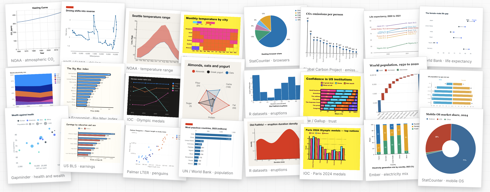
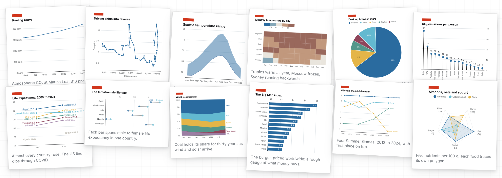

<h1> Flint: A Visualization Language for the AI Era</h1>

[](https://www.npmjs.com/package/flint-chart)
[](https://www.npmjs.com/package/flint-chart-mcp)
[](https://arxiv.org/abs/2607.20775)
[](https://github.com/microsoft/flint-chart/actions/workflows/ci.yml)
[](LICENSE)
[](https://discord.gg/hnm4Y8YX8)
[](#community)

[**Project site**](https://microsoft.github.io/flint-chart/) ·
[**中文主页**](https://microsoft.github.io/flint-chart/#/zh) ·
[**MCP server**](https://microsoft.github.io/flint-chart/#/mcp)

<p align="center">
  
</p>

Flint is a visualization language that lets **AI agents reliably
create expressive, good-looking and interactive charts from simple,
human-editable chart specs**. It is available as an
[MCP server](https://microsoft.github.io/flint-chart/#/mcp) for everyday use
with your agent, and as an [npm library](https://www.npmjs.com/package/flint-chart)
for building interactive applications.

Flint supports **52 chart types across 5 rendering backends** —
[Vega-Lite](https://vega.github.io/vega-lite/), [ECharts](https://echarts.apache.org/),
[Chart.js](https://www.chartjs.org/), [Highcharts](https://www.highcharts.com/), [Plotly](https://plotly.com/javascript/), and
native Excel charts — through one unified interface, with **14 themes and 23
interaction presets**. To create bespoke visualizations, design custom themes in
the [Theme Lab](https://microsoft.github.io/flint-chart/#/theme-lab) and build
[advanced interactions](https://microsoft.github.io/flint-chart/#/interactions/advanced)
with the Flint API.

https://github.com/user-attachments/assets/c1cda0fa-3ea7-41af-b3fd-a127bc83d641

<p align="center">
  <sub>🔊 Click the speaker icon for sound</sub>
  &nbsp;
  <a href="https://youtu.be/JAJy7ToczMs"></a>
</p>

## Updates

- **October 19, 2026** — Flint 1.0 introduces
  [Flint Interactive](https://microsoft.github.io/flint-chart/#/interactions):
  interaction presets, semantic events, and an interaction API that connects
  charts to your app. ([changelog](CHANGELOG.md))
- **August 12, 2026** — Flint 0.5.1 extends visual themes to the Plotly backend
  and adds Vega-Lite Calendar Heatmap.
- **August 5, 2026** — Flint 0.5.0 introduces formal visual themes with preset
  themes, custom ThemeSpec authoring, and preset inheritance.
  ([v0.5.0](https://github.com/microsoft/flint-chart/releases/tag/0.5.0))
- **July 24, 2026** — Flint 0.4.0 adds 38 Plotly chart types and 18 native,
  editable Excel chart templates.
  ([v0.4.0](https://github.com/microsoft/flint-chart/releases/tag/0.4.0))

See the [changelog](CHANGELOG.md) for every release.

## Get started

### In your agent app (MCP server)

Chart right in the conversation with any MCP client, such as
[GitHub Copilot in VS Code](https://code.visualstudio.com/docs/copilot/chat/mcp-servers),
[Claude](https://support.claude.com/en/articles/11175166-get-started-with-custom-connectors-using-remote-mcp),
Claude Code, Codex, or Cursor.

⚡ **Quick start:** paste this setup request into your agent and let it
configure Flint for the current project. For manual setup, see the
[MCP server guide](https://microsoft.github.io/flint-chart/#/mcp).

```text
Help me set up Flint as an MCP server named "flint"!

1. Add it to my client config, using whichever option my client supports:
   - a local (stdio) server: npx -y flint-chart-mcp
   - the hosted server over HTTP: https://flint.data-formulator.ai/mcp
2. Verify the setup by listing the available Flint chart types.
3. Show me a fun first chart: how many moons each planet has, in a Flint theme you like.
```

Then ask your agent for a chart, for example:

```text
Go to Yahoo Finance, find today's percentage change for the Magnificent Seven
tech stocks, and compare their performance with Flint in Economist style.
Let me hover to read each stock's change.
```

The agent can open an interactive chart right in the conversation, return a
static PNG or SVG, or produce a backend-native spec.

<p align="center">
  
</p>

### Build with your coding agent

Are you a developer building agent apps? Use
[`flint-chart`](https://www.npmjs.com/package/flint-chart), Flint's npm library,
to bring charts into your apps, dashboards, and data stories:

```bash
npm install flint-chart
```

The library compiles Flint specs into backend-native chart specs and provides
React and vanilla JavaScript APIs for embedding interactive charts.

A Flint spec describes the data, semantic types, and field mappings, with
optional theme and interaction settings. In React, pass it to `<FlintChart>`
to embed an interactive chart:

```tsx
import type { ChartAssemblyInput } from 'flint-chart';
import { FlintChart } from 'flint-chart/react';

const spec: ChartAssemblyInput = {
  data: { values: [
    { Month: '2026-01', Users: 1200 },
    { Month: '2026-02', Users: 1800 },
  ] },
  semantic_types: { Month: 'YearMonth', Users: 'Quantity' },
  chart_spec: {
    chartType: 'Line Chart',
    encodings: { x: 'Month', y: 'Users' },
  },
  theme_spec: 'economist',
  interaction_spec: { interactions: [{ type: 'inspect-index' }] },
};

<FlintChart spec={spec} />
```

You can copy the following instruction to your coding agent to build a chart
with Flint, then adapt it to your data and app:

```text
Read Flint's chart authoring and interaction skills:
https://github.com/microsoft/flint-chart/blob/main/agent-skills/flint-chart-author/SKILL.md
https://github.com/microsoft/flint-chart/blob/main/agent-skills/flint-interaction-author/SKILL.md

Use these skills to add a chart to this app.
Install flint-chart and the renderer dependencies needed for this project.
Plot monthly users by region from our data in Economist style.
Let readers hover to compare regions at each month, and add a region selector
that updates the chart.
Integrate it with the app's existing layout and verify it works.
```

The agent can also generate backend-native specs or editable Excel charts
for reports and documents. See the [API reference](docs/api-reference.md),
[interaction API](docs/interaction-api.md), and
[live editor](https://microsoft.github.io/flint-chart/#/editor) for the
underlying APIs and examples.

## How it works

A Flint spec consists of the data, semantic types, the chart spec, and optional
theme and interaction specs. Instead of relying on complex user-side logic to
glue them together, the compiler resolves each part against the others and
composes a complete backend-native spec.

### 1. Describe data with semantic types

Fields are described with semantic types such as `Rank`, `YearMonth`, `Delta`,
or `Temperature`, along with their domains and units. The compiler uses them to
infer parsing, scales, axes, formatting, and colors — a short Flint spec becomes
a complete backend spec.

<p align="center">
  
</p>

### 2. Build charts once, render on any backend

Charts are defined with high-level chart types and encodings. The compiler
adapts sizing, spacing, labels, and legends to the data, for example as it gets
denser, and the same spec renders across Vega-Lite, ECharts, Chart.js, and
Plotly, or as native Excel charts. See the [API reference](docs/api-reference.md)
and the [gallery](https://microsoft.github.io/flint-chart/#/gallery).

### 3. Unify the look with a theme spec

Geometry, typography, and color are reusable formal specs that apply across a
whole chart library, independent of the data and chart type. Pick one of 14
preset themes, such as the New York Times, the Economist, Swiss, or McKinsey, or
inherit one and override only what belongs to your brand:

```ts
theme_spec: { extends: 'economist', id: 'our-brand', ink: { series: { single: '#6b3fa0' } } }
```

Compare every preset in the [theme explorer](https://microsoft.github.io/flint-chart/#/themes),
design your own in the [Theme Lab](https://microsoft.github.io/flint-chart/#/theme-lab),
and see the [theme guide](docs/theme-spec.md) for the full reference.

<p align="center">
  <a href="https://microsoft.github.io/flint-chart/#/themes?theme=economist&amp;layout=banner">
    
  </a>
</p>

### 4. Add interactions with an interaction spec

Flint provides 23 interaction presets and a programming API for building
interactive charts into applications. The compiler resolves user interaction
events into semantic information, so your app only answers with high-level
chart updates:

```tsx
import { FlintChart } from 'flint-chart/react';

<FlintChart
  spec={{ ...input, interaction_spec: { interactions: [{ type: 'brush-x' }] } }}
  onChange={({ phase, state }) => {
    if (phase === 'commit') table.filter(state.selected);
  }}
/>
```

<p align="center">
  <a href="https://microsoft.github.io/flint-chart/#/interactions">
    
  </a>
</p>

Try the presets in the [interaction gallery](https://microsoft.github.io/flint-chart/#/interactions/gallery),
see bespoke ones in [advanced interactions](https://microsoft.github.io/flint-chart/#/interactions/advanced),
and read the [interaction spec](docs/interaction-spec.md) and
[programming API](docs/interaction-api.md).

## Documentation

- [Project site](https://microsoft.github.io/flint-chart/) — gallery, live editor, themes, and interactions
- [API reference](docs/api-reference.md) and backend references for
  [Vega-Lite](docs/reference-vegalite.md), [ECharts](docs/reference-echarts.md),
  [Chart.js](docs/reference-chartjs.md), [Highcharts](docs/reference-highcharts.md),
  [Plotly](docs/reference-plotly.md), and [Excel](docs/reference-excel.md)
- [Theme guide](docs/theme-spec.md), [interaction spec](docs/interaction-spec.md),
  and [interaction programming API](docs/interaction-api.md)
- [MCP server guide](https://microsoft.github.io/flint-chart/#/mcp) and
  [agent skills](agent-skills/)
- [Paper on arXiv](https://arxiv.org/abs/2607.20775)

A Python port is in preview as source in [`packages/flint-py`](packages/flint-py); its package is not yet released.

## Contributing

Contributions are welcome — especially new
[chart templates](docs/adding-a-chart-template.md) and
[rendering backends](docs/adding-a-backend.md). See
[CONTRIBUTING](.github/CONTRIBUTING.md) and the
[development guide](docs/DEVELOPMENT.md).

```bash
git clone https://github.com/microsoft/flint-chart
cd flint-chart
npm install         # workspaces: packages/flint-js, packages/flint-mcp, site

npm run typecheck   # typecheck flint-chart and flint-chart-mcp
npm run test        # Vitest for both packages
npm run build       # build both packages
npm run site        # project site, gallery, and editor at http://localhost:5274/
```

Node 18+ is required. The site aliases `flint-chart` to `packages/flint-js/src`,
so library edits hot-reload without rebuilding.

<details>
<summary>Repository layout</summary>

```
flint-chart/
├── packages/
│   ├── flint-js/       npm package `flint-chart` (TypeScript)
│   │   └── src/
│   │       ├── core/         semantics, themes, layout, decisions, shared types
│   │       ├── chart-types/  shared chart definitions and template metadata
│   │       ├── interactive/  interaction presets and runtime
│   │       ├── react/        the `<FlintChart>` React component
│   │       ├── vegalite/     Vega-Lite backend
│   │       ├── echarts/      ECharts backend
│   │       ├── chartjs/      Chart.js backend
│   │       ├── highcharts/   Highcharts backend
│   │       ├── plotly/       Plotly backend
│   │       ├── excel/        native Excel backend
│   │       └── test-data/    fixtures and stress-test generators
│   ├── flint-mcp/      MCP server `flint-chart-mcp`, MCP App UI, and tests
│   └── flint-py/       Python port preview
├── site/               Vite + React project site, gallery, editor, and docs
├── agent-skills/       chart, theme, and interaction authoring skills for agents
├── docs/               user, API, backend, and architecture documentation
└── design-docs/        design proposals and implementation research
```

</details>

This project has adopted the
[Microsoft Open Source Code of Conduct](.github/CODE_OF_CONDUCT.md). See
[SECURITY.md](.github/SECURITY.md) to report vulnerabilities.

## Community

<table>
  <tr>
    <td align="center" width="50%">
      <strong>Join the Flint Discord</strong><br>
      Ask questions, share your charts, and follow releases with Flint users everywhere.<br><br>
      <a href="https://discord.gg/hnm4Y8YX8">Join Discord</a>
    </td>
    <td align="center" width="50%">
      <strong>Join the Flint WeChat group</strong><br>
      Scan the QR code to join the Flint user WeChat group.<br><br>
      
    </td>
  </tr>
</table>

## Contributors

<p align="center">
  <a href="https://github.com/Chenglong-MS" title="Chenglong-MS"></a>
  <a href="https://github.com/xavier-shaw" title="xavier-shaw"></a>
  <a href="https://github.com/IAMkecheng" title="IAMkecheng"></a>
  <a href="https://github.com/zl190" title="zl190"></a>
  <a href="https://github.com/lx9days" title="lx9days"></a>
  <a href="https://github.com/spboyer" title="spboyer"></a>
  <a href="https://github.com/taoche" title="taoche"></a>
  <a href="https://github.com/zhb-y-agent" title="zhb-y-agent"></a>
  <a href="https://github.com/zhnd" title="zhnd"></a>
  <a href="https://github.com/yelper" title="yelper"></a>
  <a href="https://github.com/chen1plus" title="chen1plus"></a>
  <a href="https://github.com/FGRibreau" title="FGRibreau"></a>
  <a href="https://github.com/Hughhhhcoder" title="Hughhhhcoder"></a>
  <a href="https://github.com/joshpoll" title="joshpoll"></a>
  <a href="https://github.com/nyxst4ck" title="nyxst4ck"></a>
  <a href="https://github.com/fix2015" title="fix2015"></a>
</p>

<p align="center">
  <strong>We'd love to have <em>you</em> join us!</strong> Pick up an
  <a href="https://github.com/microsoft/flint-chart/issues">issue</a>, add a chart
  template or a theme, or share what you build in the community.
  See <a href="#contributing">Contributing</a> to get started, and everyone on the
  <a href="https://github.com/microsoft/flint-chart/graphs/contributors">contributors graph</a>.
</p>

## Trademarks

This project may contain trademarks or logos for projects, products, or services.
Authorized use of Microsoft trademarks or logos is subject to and must follow
[Microsoft's Trademark & Brand Guidelines](https://www.microsoft.com/en-us/legal/intellectualproperty/trademarks/usage/general).
Use of Microsoft trademarks or logos in modified versions of this project must not
cause confusion or imply Microsoft sponsorship. Any use of third-party trademarks
or logos is subject to those third parties' policies.

## License

[MIT](LICENSE) © Microsoft Corporation
